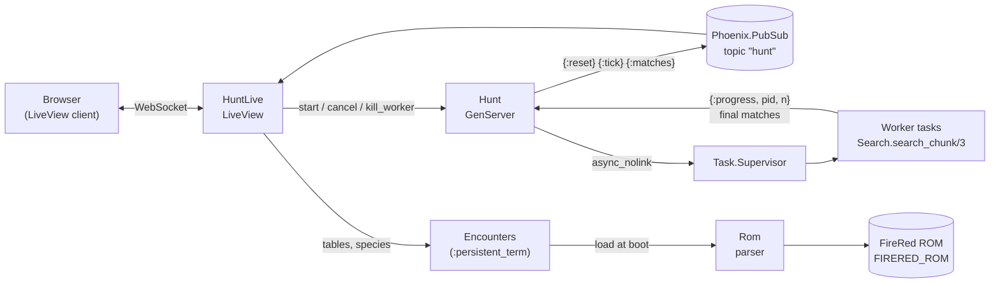

# Architecture

Shiny Hunter rebuilds FireRed's wild Pokémon generation from the ROM, then searches every seed × advance combination in parallel on the BEAM. The heavy work lives in pure functions; coordination lives in a single process, `ShinyHunter.Hunt`, which hands seed blocks to supervised tasks.

This document covers why the project exists, how the game logic was extracted with REA, how the app is built, how its correctness was verified, and how fast it runs.

## Why

The goal was to show Elixir's strength at parallel processing in a light-hearted way, as a fun project rather than a talk. A FireRed shiny hunter fits that well:

- **Reverse engineering has a real role**: someone has to find out how the game works inside.
- **The problem is embarrassingly parallel**: millions of independent seed and advance combinations.
- **The theme is fun**, and the gain from parallelism is easy to see and measure: more cores, more Pokémon per second.

An exhaustive search was chosen on purpose, because every combination is independent of the others.

## REA

REA (Reverse Engineer Anything, v6.5.0, package `rea-agents`) is a local reverse engineering tool that gives CLIs and AI agents, over MCP, a single interface to engines such as Ghidra, IDA and Hopper. This project used it with **Ghidra 12.1.4** as the analysis engine.

Three of its traits mattered here:

- **Headerless binaries.** A GBA ROM has no executable format. REA loads it as `raw-binary`, architecture `arm`, mapped at `0x8000000`, which is exactly where the cartridge sits in GBA memory.
- **Evidence with provenance.** Every answer carries the ROM hash, the Ghidra version and the analysis profile, so every claim can be traced back.
- **Read only.** Ghidra works on a temporary database and never changes the ROM.

**How it was used.** Each CLI command restarts Ghidra and re-analyses the ROM, which takes about 10 minutes. To ask many questions in a row, REA ran as an MCP server (`rea --mcp`) behind a small local bridge: the ROM is analysed once and every later question returns in seconds. The MCP tools used most were `open_binary`, `analyze_function`, `batch_decompile`, `procedure_references`, `xrefs`, `inspect_native_instruction` and `close_binary`.

A single CLI query looks like this:

```bash
export JAVA_HOME=/path/to/jdk-21        # REA needs a full JDK, not just a JRE
export GHIDRA_INSTALL_DIR=/path/to/ghidra_12.1.4_PUBLIC
export REA_GHIDRA_STARTUP_TIMEOUT_MS=1800000   # the 5.5 min default is not enough for a 16 MB ROM

node scripts/rea.mjs function firered.gba 0x8044EC8 \
  --target-format raw-binary --architecture arm --entry-point 0x8000000 \
  --provider ghidra --json
```

## What REA found

All game logic the search reproduces came out of the ROM through REA, in three analysis rounds. The ROM is FireRed (USA) v1.0, SHA-1 `41cb23d8dccc8ebd7c649cd8fbb58eeace6e2fdc`, the same one the community decompilation `pret/pokefirered` reproduces.

| Finding | ROM address | How it was found |
| --- | --- | --- |
| RNG (`Random()`): `seed × 0x41C64E6D + 0x6073`, returns the high 16 bits | `0x8044EC8`; seed in RAM at `0x03005000` | Searched the ROM bytes for the LCG constants, then `analyze_function` |
| Pokémon creation (`CreateBoxMon`): PID, trainer ID, IVs, shiny check | `0x803DAC4` | Among the 93 callers of `Random()`, the one calling it 6 times |
| Shiny check: `TID ^ SID ^ PID_high ^ PID_low < 8` | inside `0x803DAC4` | Ghidra pseudocode, masks read from the ROM |
| Nature roll: `Random() % 25` | `0x80829FC` | Callers of `CreateMonWithNature` |
| PID rerolled until the nature matches (low half first) | `0x803DD98` | `batch_decompile` |
| Slot roll (land, water/Rock Smash, fishing) | `0x808274C`, `0x8082808`, `0x808285C` | Callers of the wild creation routine |
| Level roll: `min + Random() % range` | `0x80828F8` | Same |
| Per-step encounter and encounter check | `0x8082CBC`, `0x8082BCC` | `procedure_references` |
| 16-bit seed read from the Timer 1 counter | `0x8044EE8` and `0x8000564`; timer at `0x04000104` | The only write to `0x03005000` besides `Random()` |
| Per-map encounter headers (132 records of 20 bytes) | `0x83C9CB8`, read by `0x8082934` | Pseudocode of the current-map lookup |
| Map groups and map section (byte `+0x14`) | `0x83526A8`, `0x8055238`, `0x8056260` | Same |
| Map names (109, index = section − `0x58`) | `0x83F1CAC`, used by `0x80C4D78` | `xrefs` + `inspect_native_instruction` |
| Species names (11 bytes each) | `0x8245EE0`, used by `0x8040FD0` | Pseudocode of `GetSpeciesName` |

Function names in parentheses come from comparing with the community decompilation; REA itself only shows addresses and code. The modules `ShinyHunter.Rng`, `ShinyHunter.Wild` and `ShinyHunter.Rom` cite these addresses in their docs.

## Components



| Module | Role |
| --- | --- |
| `ShinyHunter.Rng` | The game's LCG. `next/1` steps once, `jump/2` steps N times in O(log N) with a precomputed table of 2^i jumps. |
| `ShinyHunter.Wild` | Generates one wild Pokémon from an RNG state, in the exact order the game draws from `Random()`. Returns a bare tuple, since the search calls it billions of times. |
| `ShinyHunter.Search` | Splits the seed range into blocks and scans one block: for each seed, jump to the first advance, then step through the advances and apply the filters. Pure functions, no processes. |
| `ShinyHunter.Hunt` | The only stateful process. Owns the queue of blocks, starts at most `concurrency` tasks, collects matches, requeues blocks of dead tasks and broadcasts progress every 200 ms. |
| `ShinyHunter.Rom` | Parses the ROM after checking its SHA-1. Every pointer and read is bounds-checked; one bad value fails the whole parse. |
| `ShinyHunter.Encounters` | Loads the tables once at boot into `:persistent_term`, labels maps, and maps an encounter type to the slot area `Wild` rolls with and the table it reads. |
| `ShinyHunterWeb.HuntLive` | The page. Validates the form, starts hunts and renders the stats and a stream of results. |

### Supervision tree

```
ShinyHunter.Supervisor (one_for_one)
├── ShinyHunterWeb.Telemetry
├── DNSCluster
├── Phoenix.PubSub (ShinyHunter.PubSub)
├── Task.Supervisor (ShinyHunter.TaskSupervisor)   ← workers live here
├── ShinyHunter.Hunt
└── ShinyHunterWeb.Endpoint
```

`Encounters.load/0` runs in `Application.start/2`, before the tree, so the tables are ready before the first request.

## How a hunt runs

1. The LiveView parses the form into a `%Search.Params{}`: TID, SID, slot area, a slot bitmask, a nature bitmask, minimum IVs and the seed and advance ranges. A chosen species becomes the bitmask of every slot it fills.
2. `Hunt.start/3` kills the previous hunt's tasks, splits the seeds into blocks of 16 consecutive seeds and fills up to `concurrency` slots with `Task.Supervisor.async_nolink/2`.
3. Each task runs `Search.search_chunk/3`. Per seed it calls `Rng.jump/2` to reach the first advance, then walks the advances one `Rng.next/1` at a time, generating and filtering a Pokémon at each step. After each seed it sends `{:progress, pid, n}` to the hunt.
4. When a task replies with its matches, the hunt adds the block's full size to `completed`, keeps up to 500 matches overall, broadcasts the new ones and starts the next block.
5. A `:tick` every 200 ms computes the rate and broadcasts the stats. When the queue and the running set are both empty, the hunt is `:done`.

The page never polls the hunt. It reads one snapshot on mount, then only receives what the hunt publishes on PubSub. That is also why a hunt is global and survives closing the tab.

## Fault tolerance

Tasks are started with `async_nolink`, so they are monitored but not linked to the hunt: a task dying does not take the hunt down.

- **A task crashes or is killed**: the hunt receives `:DOWN`, removes the worker, puts its block back at the front of the queue and starts a new task. The block's partial progress is discarded, so every block is counted exactly once.
- **Kill a worker** picks a random running task, kills it with `Process.exit(pid, :kill)`, demonitors it with `:flush` and requeues its block right away. Removing the worker immediately, instead of waiting for `:DOWN`, means a fast double click can never kill the same process twice or count one crash twice. This bug was caught by the tests and fixed this way.
- **Late messages** from a killed task (a reply already in the mailbox, a stray progress message) carry an unknown ref or pid and are ignored.

## Performance notes

- **Small integers only.** The RNG multiplication exceeds 60 bits, which the BEAM turns into a bignum, and bignums are slow. `Rng.mul/2` splits the multiplier into 16-bit halves so every intermediate value stays a small integer.
- **Jump, then step.** Reaching advance `a` of a seed costs O(log a) with `Rng.jump/2`; after that each advance is one `Rng.next/1`.
- **Bitmasks for filters.** Slots and natures are checked with a shift and an AND, and the shiny check comes first, so most candidates are rejected in a few instructions.
- **Bare tuples in the hot loop.** `Wild.generate/2` returns `{slot, level_roll, pid, iv1, iv2}`; maps are only built for results shown on screen.

Measured on a machine with 6 physical cores and 12 threads, `prod` build:

| Measurement | Result |
| --- | --- |
| 8.2 million Pokémon, 1 worker | 9.3 s (~877 thousand/s) |
| 8.2 million Pokémon, 12 workers | 1.5 s (~5.6 million/s) |
| Full grid: 65,536 seeds × 10,000 advances, 2 workers killed mid-run | 655 million in 110 s, 79,247 shinies |

12 workers are 6.4× faster than 1, close to linear in the physical cores. The full grid was measured before slot and level rolls were added, which cost about 7% of throughput. The 79,247 shinies match the theoretical 1 in 8,192, which predicts about 80,000.

## Verification

The Elixir code was checked against the game's own code running in an emulator, not only against our reading of it. There are three layers, from weakest to strongest:

| Layer | What it compares | Cases | Needs the ROM |
| --- | --- | --- | --- |
| C reference | Elixir against a literal C translation of the pseudocode REA extracted (`test/support/reference/firered_wild.c`) | 5,003 | No |
| ROM emulation | Elixir against the ROM's routines running in the Unicorn ARM emulator: slot, species, level, PID, trainer ID, the 6 IVs and the final RNG state | 6,018, across all 6 encounter types | Yes |
| Known tables | Tables read from the ROM against well-known encounters: Route 1 with Pidgey and Rattata at 50% each, Pikachu at 5% in Viridian Forest, Clefairy at 1% in Mt. Moon | 5 tests | Yes |

**How the emulation works.** `test/support/rom/emulate_wild.py` loads the ROM into GBA memory, writes the seed at `0x03005000` and calls the game's real encounter routine (`0x8082AEC`, or `0x8082B64` for fishing) over a synthetic encounter table. It intercepts `0x80404D0`, the function that sets each field of the Pokémon, to read what the game produced. Matching the final RNG state proves the game and the Elixir code made exactly the same number of draws.

**Mutation testing.** To make sure the comparison catches errors, faults were introduced on purpose and the tests were confirmed to fail:

- Swapping the PID halves fails on the first case.
- Changing one grass slot threshold from 98 to 97 fails with "slot differs".

## Known limitations

- **Where counting starts.** The search starts at the moment the encounter has begun. The per-step encounter check (`0x8082BCC`) is not modelled; this matches how community calculators count advances.
- **Unown and static Pokémon.** Unown uses another creation routine, and the page refuses hunts in the Tanoby chambers. Legendaries and starters also use another routine, not analysed.
- **Other versions.** Every address is from the USA v1.0 release. A different ROM is rejected by its SHA-1.
- **Map tables.** The layout of each area's list was confirmed in the emulator. The header table and names were confirmed by reading the code and by known maps, without emulating the routine that picks the current map's header.
- **Alternate names.** One special case of map naming (`0x80C4D40`) was not investigated. None of the 132 maps with encounters came out unnamed or oddly named.

## Possible next steps

- Distribute the search across machines with `Node.connect/1`.
- Model the per-step encounter check, to count advances from boot.
- Analyse the creation of legendaries and starters with REA.
